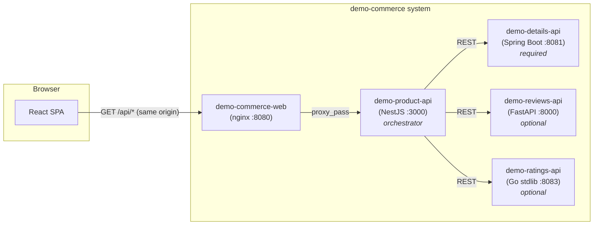
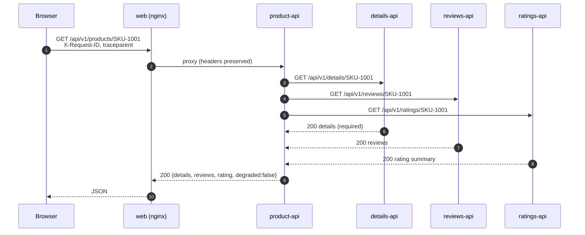
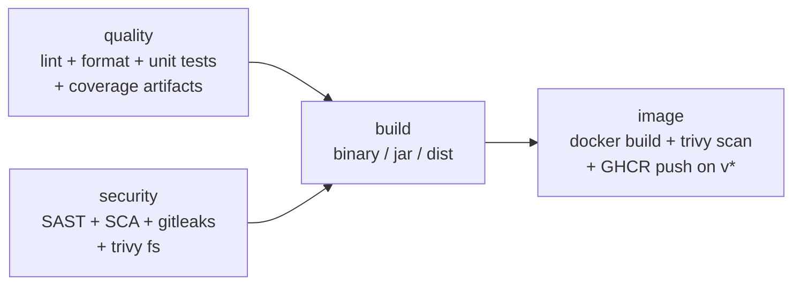

# Demo Commerce Platform — Architecture

Five independent repositories forming one reference system for devex.io
governance, catalog and CI/CD testing. Inspired by Istio's Bookinfo:
polyglot leaf services behind a single orchestrator behind a thin SPA.

## System diagram



## Repository map

| Repo | Stack | Role | Port |
| ---- | ----- | ---- | ---- |
| `demo-commerce-web` | React 19, Vite 6, TS, Vitest+RTL+msw | Storefront SPA + nginx proxy | 8080 |
| `demo-product-api` | NestJS 11, TS, Jest, pino, prom-client, OTel | Orchestration / BFF | 3000 |
| `demo-details-api` | Spring Boot 3.5, Java 21, JUnit 5, Micrometer | Product details | 8081 |
| `demo-reviews-api` | FastAPI, Python 3.12, pytest, structlog | Customer reviews | 8000 |
| `demo-ratings-api` | Go 1.27 **stdlib only**, go test, slog | Product ratings | 8083 |

Each repo is independently buildable/testable/deployable — no monorepo,
no shared code. Contract stability is maintained by the OpenAPI specs in
`docs/api/openapi.yaml` of each backend repo.

## Request flow (aggregated product page)



If no inbound `traceparent` exists, the orchestrator generates a root one;
the same `trace_id` then appears in the logs of every hop — verified
end-to-end in `docs/validation-report.md`.

## Degradation contract

| Downstream down | Orchestrator response |
| --------------- | --------------------- |
| details-api | `502` (propagated; 404 for unknown SKU) |
| reviews-api and/or ratings-api | `200` + `degraded: true`, empty reviews / `rating: null` |

## Contracts

| API | OpenAPI |
| --- | ------- |
| product-api | `docs/api/openapi.yaml` (this repo) |
| details-api | `demo-details-api/docs/api/openapi.yaml` |
| reviews-api | `demo-reviews-api/docs/api/openapi.yaml` |
| ratings-api | `demo-ratings-api/docs/api/openapi.yaml` |

Shared sample SKUs: `SKU-1001` Aurora Coffee Maker, `SKU-1002` Nimbus
Keyboard, `SKU-1003` Atlas Standing Desk.

## Local development

```bash
# Everything, containerized (from this repo):
docker compose -f deploy/platform/docker-compose.yaml up -d --build

# Or per-service on the host (see each repo's README/Makefile):
#   ratings → make run (:8083)   reviews → make run (:8000)
#   details → make run (:8081)   product → npm run start:dev (:3000)
#   web     → npm run dev (:5173, /api proxied to :3000)
```

## CI/CD

Every repo has an identical 4-job GitHub Actions pipeline:



Tooling per language: gofmt/vet/govulncheck (Go), ruff/mypy/bandit/
pip-audit (Python), spotless/JaCoCo/OWASP dep-check (Java), prettier/
eslint/npm audit (TypeScript). Container scans are Trivy SARIF;
publishing is gated to `v*` tags → `ghcr.io/<owner>/<repo>:<semver>`.

## Kubernetes

- Per-repo `deploy/kubernetes/` — Deployment + Service + ConfigMap +
  kustomization (non-root, read-only rootfs, dropped caps, requests/
  limits, liveness+readiness probes, Prometheus scrape annotations).
- `deploy/platform/` (this repo) — namespace + umbrella kustomization
  referencing the sibling checkouts; `kubectl apply -k deploy/platform`.
- Service discovery via in-cluster DNS (`http://demo-details-api:8081`,
  …) wired through ConfigMaps — no Istio required; a mesh can be added
  as an optional layer without code changes.

## Observability

Uniform contract on all four backends:

- `GET /healthz`, `GET /readyz`, `GET /metrics` (Prometheus text)
- Structured JSON logs carrying `request_id` + `trace_id`
- W3C `traceparent` propagation end-to-end; `X-Request-ID` honored or
  generated at the edge and forwarded downstream
- Optional OTLP export via `OTEL_EXPORTER_OTLP_ENDPOINT`
- `FAIL_READINESS=true` forces readiness 503 for governance demos

## Backstage catalog

- This repo anchors `Domain:commerce`, `System:demo-commerce` and
  `Group:platform-team`; every repo contributes its `Component` (+ `API`
  entities with inline OpenAPI `$text` refs).
- Validate locally: `node scripts/validate-catalog.mjs`.
- devex.io registration + required `app-config.yaml` patch:
  `docs/devexio-integration.md`.

## Governance scenarios

`docs/governance/scenarios.md` — 13 deterministic, reversible failure
recipes (pipeline, coverage, lint, SCA, image scan, build, deploy,
health, API comms, catalog metadata, ownership, outdated deps).
