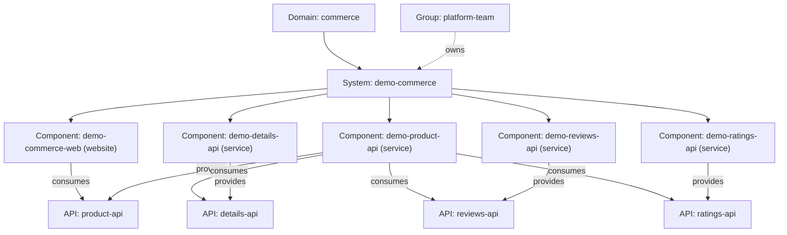

# Registering the Demo Commerce Platform in devex.io

devex.io is the Backstage-based IDP in `~/repos/devexio`. This document
covers registering the five `catalog-info.yaml` descriptors and the one
config patch its default rules require.

## 1. Required `app-config.yaml` patch

devex.io's stock config restricts importable entity kinds:

```yaml
catalog:
  rules:
    - allow: [Component, System, API, Resource, Location]
```

The platform adds `Domain` and `Group` entities, so extend the rule:

```yaml
catalog:
  rules:
    - allow: [Component, System, API, Resource, Location, Domain, Group]
```

Without this, registration of `Domain:commerce` and
`Group:platform-team` fails with
`Entity kind Domain is not allowed in this location`.

## 2. Locations to register

Because these are local git checkouts (no remotes), register them with
the catalog's file/URL locations or via the Backstage UI
"Register existing component" using `file://` targets, e.g.:

```yaml
# app-config.local.yaml — dev-only catalog locations
catalog:
  locations:
    - type: file
      target: /home/krieger/repos/demo-product-api/catalog-info.yaml
      rules: [allow: [Component, System, API, Domain, Group]]
    - type: file
      target: /home/krieger/repos/demo-details-api/catalog-info.yaml
      rules: [allow: [Component, API]]
    - type: file
      target: /home/krieger/repos/demo-reviews-api/catalog-info.yaml
      rules: [allow: [Component, API]]
    - type: file
      target: /home/krieger/repos/demo-ratings-api/catalog-info.yaml
      rules: [allow: [Component, API]]
    - type: file
      target: /home/krieger/repos/demo-commerce-web/catalog-info.yaml
      rules: [allow: [Component]]
```

Register `demo-product-api` first — it anchors the Domain, System and
Group the other descriptors reference.

Once the repos have GitHub remotes, switch `type: file` to `type: url`
with the repo `catalog-info.yaml` raw URLs — no descriptor changes needed.

## 3. Validate before registering

```bash
cd ~/repos/demo-product-api
node scripts/validate-catalog.mjs        # expects: OK — 12 entities
```

## 4. Expected entity graph



## 5. Troubleshooting

| Symptom | Cause | Fix |
| ------- | ----- | --- |
| `kind Domain is not allowed` | catalog.rules too narrow | apply the patch in §1 |
| `owner ... could not be resolved` | product-api not registered yet / wrong order | register the anchor descriptor first |
| API entity shows no definition | relative `$text` path | keep `docs/api/openapi.yaml` next to the descriptor (file locations resolve relative paths) |
